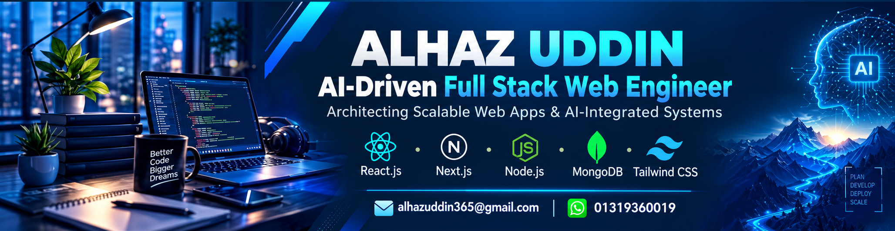
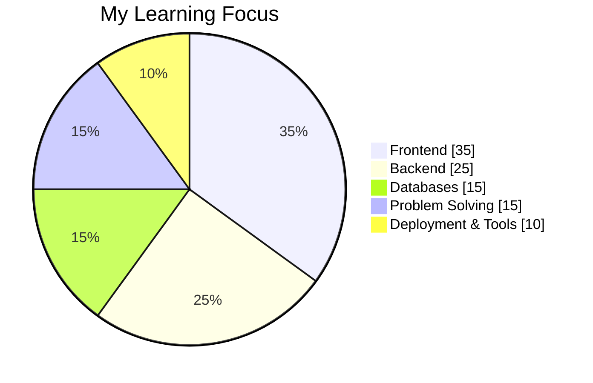
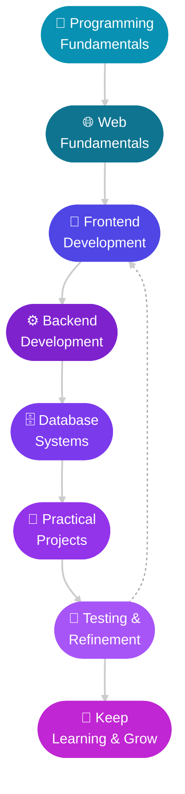

<!-- ================================================== -->
<!--                  PROFILE BANNER                   -->
<!-- ================================================== -->

<p align="center">
  
</p>

<!-- ================================================== -->
<!--              ANIMATED INTRODUCTION                -->
<!-- ================================================== -->

<p align="center">
  
</p>

<!-- ================================================== -->
<!--                    TAGLINE                         -->
<!-- ================================================== -->

<p align="center">
  <b><i>Curiosity creates ideas. Code turns them into reality.</i></b>
</p>

<!-- ================================================== -->
<!--                  SOCIAL LINKS                      -->
<!-- ================================================== -->

<p align="center">
  <a href="mailto:alhazuddin365@gmail.com">
    
  </a>
  <a href="mailto:alhazuddin365@gmail.com">
    
  </a>
  <a href="https://github.com/alhazuddin07">
    
  </a>
  <a href="https://github.com/alhazuddin07">
    
  </a>
  <a href="https://github.com/alhazuddin07?tab=repositories">
    
  </a>
  <a href="https://github.com/alhazuddin07?tab=repositories">
    
  </a>
</p>

<!-- ================================================== -->
<!--                GITHUB PROFILE STATS                -->
<!-- ================================================== -->

<p align="center">
  
  
  
</p>

<br/>

<!-- ================================================== -->
<!--                DEVELOPER INFORMATION               -->
<!-- ================================================== -->

<p align="center">
  
  
  
</p>

---

## 📑 Quick Navigation

<p align="center">
  <a href="#-about-me">About Me</a> •
  <a href="#-my-code-identity">Code Identity</a> •
  <a href="#-technology-stack">Tech Stack</a> •
  <a href="#-skills--concepts">Skills</a> •
  <a href="#-featured-projects">Projects</a> •
  <a href="#-currently-learning">Learning</a> •
  <a href="#-my-learning-focus">Learning Focus</a> •
  <a href="#-github-analytics">GitHub Stats</a> •
  <a href="#-my-developer-roadmap">Roadmap</a> •
  <a href="#-my-continuous-learning-journey">Learning Journey</a> •
  <a href="#-contact-me">Contact</a>
</p>

---

## 🧬 About Me

I'm a passionate web developer from Bangladesh 🇧🇩 who enjoys building full-stack web applications and exploring modern web technologies.

| | |
|---|---|
| 🎯 Role | Full-Stack Web Developer |
| 🌱 Currently learning | Advanced Next.js and TypeScript |
| 💻 Interested in | Frontend and Backend Development |
| 🛠️ Focus | Building real-world projects |
| 🧠 Mindset | Learn, Build, Debug, Improve |
| 🎯 Goal | Become a skilled Full-Stack Developer |

> "Great things are built one line of code at a time."

---

## 💻 My Code Identity

```javascript
const alhaz = {
  name: "Alhaz Uddin",
  from: "Bangladesh 🇧🇩",
  role: "Full-Stack Web Developer in Progress",
  learning: [
    "Frontend",
    "Backend",
    "Databases",
    "Real-world projects"
  ],
  mindset: "Learn the fundamentals, improve through practice",
  currentGoal: "Build practical projects and keep growing",
  contact: "alhazuddin365@gmail.com",

  motto() {
    return "Learn. Build. Improve.";
  },
};
```

---

## ⚡ Technology Stack

<div align="center">

### 💻 Programming Languages


### 🎨 Frontend Development


### ⚙️ Backend Development


### 🗄️ Databases & Authentication


### 🛠️ Tools & Platforms


### 🏷️ Quick Badge View

<p>
  
  
  
  
  
  
  
  
  
  
  
  
  
  
  
  
</p>

</div>

---

## 🧰 Skills & Concepts

<table width="100%" border="1" cellpadding="12" cellspacing="8">
  <tr>
    <td width="50%" valign="top">
      <div align="center">
        <h3>🎨 Frontend Development</h3>
        
      </div>
      <ul>
        <li>Responsive Web Design</li>
        <li>React Components</li>
        <li>Props, State and Hooks</li>
        <li>Next.js App Router</li>
        <li>TypeScript and TSX</li>
        <li>Tailwind CSS</li>
        <li>Server-Side Rendering (SSR)</li>
        <li>Static Site Generation (SSG)</li>
        <li>API Integration and Data Fetching</li>
      </ul>
    </td>
    <td width="50%" valign="top">
      <div align="center">
        <h3>⚙️ Backend Development</h3>
        
      </div>
      <ul>
        <li>Node.js and Express.js</li>
        <li>RESTful API Development</li>
        <li>CRUD Operations</li>
        <li>Authentication and Authorization</li>
        <li>JWT and Better Auth</li>
        <li>Middleware and Error Handling</li>
        <li>Third-party API Integration</li>
      </ul>
    </td>
  </tr>
  <tr>
    <td width="50%" valign="top">
      <div align="center">
        <h3>🗄️ Database Management</h3>
        
      </div>
      <ul>
        <li>MongoDB</li>
        <li>Database Design</li>
        <li>CRUD Operations</li>
        <li>Data Modeling</li>
        <li>Query Operations</li>
        <li>Data Management</li>
      </ul>
    </td>
    <td width="50%" valign="top">
      <div align="center">
        <h3>🚀 Development Workflow</h3>
        
      </div>
      <ul>
        <li>Git and GitHub</li>
        <li>Debugging and Problem Solving</li>
        <li>Environment Configuration</li>
        <li>Vercel Deployment</li>
        <li>API Testing with Postman</li>
        <li>Clean Code Practices</li>
      </ul>
    </td>
  </tr>
</table>

---


## 🚀 Featured Projects

### 1. 📚 Book Nook

A library management application where users can explore books, borrow books, and manage their reading activities.

**Technologies:** Next.js, TypeScript, MongoDB, Better Auth, Tailwind CSS.

🌐 [Live Demo](https://book-nook-frontend-lemon.vercel.app/)

---

### 2. 💪 FITLOG

A workout library application that helps users explore exercises and manage their workout plans.

**Technologies:** Next.js, TypeScript, Tailwind CSS, REST API.

🌐 [Live Demo](https://assignment-number-6-seven.vercel.app/)

---

### 3. 💼 Wanderlust

A job board application where users can explore job opportunities and manage job-related activities.

**Technologies:** Next.js, TypeScript, Express.js, MongoDB.

🌐 [Live Demo](https://wanderlust-frontend-phi.vercel.app/)


---

## 🔬 Currently Learning

| Area | Focus |
|---|---|
| Next.js | Advanced App Router and rendering |
| TypeScript | Advanced types and application architecture |
| Backend | Scalable REST API development |
| Authentication | Secure authentication systems |
| Database | Better database design and optimization |
| Problem Solving | Improving programming fundamentals |

---

## 📚 My Learning Focus



---

## 📊 GitHub Analytics

<!-- GitHub Stats and Most Used Languages -->

<div align="center">

  

  

</div>

<!-- GitHub Contribution Streak -->

<p align="center">
  
</p>

<!-- GitHub Contribution Activity Graph -->

<h3 align="center">📈 Contribution Activity</h3>

<p align="center">
  
</p>

<!-- Statistics Information -->

<details>
  <summary><b>📌 About these statistics</b></summary>

  <br/>

  - GitHub Stats display repository and contribution-related information.
  - Most Used Languages shows the distribution of code across repositories.
  - Contribution Streak displays consecutive days of contributions.
  - Contribution Activity Graph visualizes contribution activity over time.

  <br/>

  **Note:** These statistics are provided by third-party services. Updates may be delayed due to caching, and private repository activity may not be included.

</details>

---

## 🗺️ My Developer Roadmap



---

## 🧠 My Development Principles

- 🔍 Always stay curious and keep learning.
- 🧱 Build strong programming fundamentals.
- 🧪 Learn by building real-world projects.
- 🧹 Write clean and maintainable code.
- 🐛 Debug, learn from mistakes, and improve.
- 🤝 Collaborate and share knowledge.
- 🚀 Stay consistent and never stop growing.

---

## 🎯 My Continuous Learning Journey

```mermaid
flowchart LR
    subgraph F[" "]
        direction TB
        A["Foundation"]
        A1["Programming basics"]
        A2["HTML, CSS,<br/>JavaScript"]
        A --> A1
        A1 --> A2
    end

    subgraph FE[" "]
        direction TB
        B["Frontend"]
        B1["React and Tailwind CSS"]
        B2["Responsive,<br/>accessible UI"]
        B --> B1
        B1 --> B2
    end

    subgraph BE[" "]
        direction TB
        C["Backend"]
        C1["Node.js and Express"]
        C2["REST APIs and<br/>authentication"]
        C --> C1
        C1 --> C2
    end

    subgraph DB[" "]
        direction TB
        D["Databases"]
        D1["MongoDB and SQL"]
        D2["Data modeling"]
        D --> D1
        D1 --> D2
    end

    subgraph P[" "]
        direction TB
        E["Projects"]
        E1["Full-stack<br/>applications"]
        E2["Deployment and<br/>documentation"]
        E --> E1
        E1 --> E2
    end

    classDef foundation fill:#222222,stroke:#cccccc,color:#ffffff,stroke-width:1px
    classDef frontend fill:#160000,stroke:#cccccc,color:#ffffff,stroke-width:1px
    classDef backend fill:#4a103c,stroke:#cccccc,color:#ffffff,stroke-width:1px
    classDef database fill:#40565d,stroke:#cccccc,color:#ffffff,stroke-width:1px
    classDef projects fill:#59351f,stroke:#cccccc,color:#ffffff,stroke-width:1px

    class A,A1,A2 foundation
    class B,B1,B2 frontend
    class C,C1,C2 backend
    class D,D1,D2 database
    class E,E1,E2 projects

    style F fill:transparent,stroke:transparent
    style FE fill:transparent,stroke:transparent
    style BE fill:transparent,stroke:transparent
    style DB fill:transparent,stroke:transparent
    style P fill:transparent,stroke:transparent

    linkStyle default stroke:#aaaaaa,stroke-width:1.5px
```



---

## 🤝 Contact Me

<p align="center">
  <b>Have a question or want to connect?</b>
  <br/>
  The email button below opens a new message addressed to
  <a href="mailto:alhazuddin365@gmail.com">alhazuddin365@gmail.com</a>
  in your email app.
</p>

<p align="center">
  <a href="mailto:alhazuddin365@gmail.com">
    
  </a>
  <a href="https://github.com/alhazuddin07">
    
  </a>
  <a href="https://github.com/alhazuddin07?tab=repositories">
    
  </a>
</p>

<br/>

<h3 align="center">
  Thanks for visiting my GitHub profile! 💙
</h3>

<p align="center">
  <b>Keep learning. Keep building. Keep moving forward.</b>
</p>

<br/>

<!-- ================= FOOTER WAVE ================= -->


