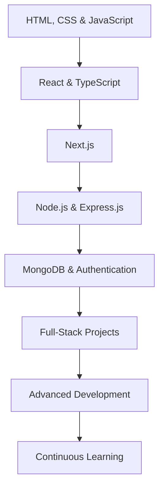

# Hi there, I'm Alhaz Uddin! 👋

### 💻 Full-Stack Web Developer | Next.js | React | TypeScript

I enjoy building modern, responsive, and user-friendly web applications. I'm passionate about learning new technologies, solving problems, and turning ideas into practical digital solutions.

---

## 📑 Quick Navigation

[About Me](#-about-me) • [Code Identity](#-my-code-identity) • [Tech Stack](#-technology-stack) • [Skills](#-skills--concepts) • [Projects](#-featured-projects) • [Learning](#-currently-learning) • [GitHub Stats](#-github-analytics) • [Contact](#-connect-with-me)

---

## 🧬 About Me

I'm a passionate web developer from Bangladesh 🇧🇩 who enjoys building full-stack web applications and exploring modern web technologies.

| | |
|---|---|
| 🎯 Role | Full-Stack Web Developer |
| 🌱 Currently learning | Advanced Next.js and TypeScript |
| 💻 Interested in | Frontend and Backend Development |
| 🛠️ Focus | Building real-world projects |
| 🧠 Mindset | Learn, Build, Debug, Improve |
| 🎯 Goal | Become a skilled Full-Stack Developer |

> "Great things are built one line of code at a time."

---

## 💻 My Code Identity

```javascript
const alhaz = {
  name: "Alhaz Uddin",
  location: "Bangladesh 🇧🇩",
  role: "Full-Stack Web Developer",

  technologies: {
    frontend: ["React", "Next.js", "TypeScript"],
    backend: ["Node.js", "Express.js"],
    database: ["MongoDB"],
    styling: ["Tailwind CSS"]
  },

  tools: ["Git", "GitHub", "VS Code", "Postman"],

  currentFocus: "Building full-stack applications",

  motto: "Learn. Build. Improve."
};
```

---

## ⚡ Technology Stack

### 🎨 Frontend Development


### ⚙️ Backend Development


### 🗄️ Database & Authentication


### 🛠️ Tools & Platforms


---

## 🧰 Skills & Concepts

### 🎨 Frontend
- Responsive Web Design
- React Components, Props, State and Hooks
- Next.js App Router
- TypeScript and TSX
- Tailwind CSS
- Server-Side Rendering (SSR)
- Static Site Generation (SSG)
- API Integration and Data Fetching

### ⚙️ Backend
- Node.js and Express.js
- RESTful API Development
- CRUD Operations
- Authentication and Authorization
- JWT and Better Auth
- Middleware and Error Handling
- Third-party API Integration

### 🗄️ Database
- MongoDB
- Database Design and CRUD
- Data Modeling
- Query Operations

### 🚀 Development Workflow
- Git and GitHub
- Debugging and Problem Solving
- Environment Configuration
- Vercel Deployment
- API Testing with Postman

---

## 🚀 Featured Projects

### 1. 📚 Book Nook
A library management application where users can explore books, borrow books, and manage their reading activities.

**Technologies:** Next.js, TypeScript, MongoDB, Better Auth, Tailwind CSS.

### 2. 💪 FITLOG
A workout library application that helps users explore exercises and manage their workout plans.

**Technologies:** Next.js, TypeScript, Tailwind CSS, REST API.

### 3. 💼 Wanderlust
A job board application where users can explore job opportunities and manage job-related activities.

**Technologies:** Next.js, TypeScript, Express.js, MongoDB.

🌐 [Live Website](https://wanderlust-frontend-phi.vercel.app/)

---

## 🔬 Currently Learning

| Area | Focus |
|---|---|
| Next.js | Advanced App Router and rendering |
| TypeScript | Advanced types and application architecture |
| Backend | Scalable REST API development |
| Authentication | Secure authentication systems |
| Database | Better database design and optimization |
| Problem Solving | Improving programming fundamentals |

---

## 📊 GitHub Analytics

<div align="center">


</div>

---

## 🗺️ My Developer Roadmap



---

## 🧠 My Development Principles

- 🔍 Always stay curious and keep learning.
- 🧱 Build strong programming fundamentals.
- 🧪 Learn by building real-world projects.
- 🧹 Write clean and maintainable code.
- 🐛 Debug, learn from mistakes, and improve.
- 🤝 Collaborate and share knowledge.
- 🚀 Stay consistent and never stop growing.

---

## 🤝 Connect With Me

I'm always interested in connecting with developers, learning new things, and collaborating on interesting projects.

- 💻 GitHub: [@alhazuddin07](https://github.com/alhazuddin07)
- 📧 Email: YOUR_EMAIL
- 💼 LinkedIn: YOUR_LINKEDIN_URL
- 🌐 Portfolio: YOUR_PORTFOLIO_URL

---

### 💙 Thanks for visiting my GitHub profile!

**Keep Learning • Keep Building • Keep Improving 🚀**
